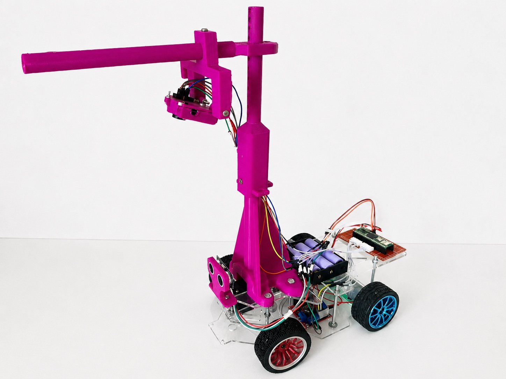
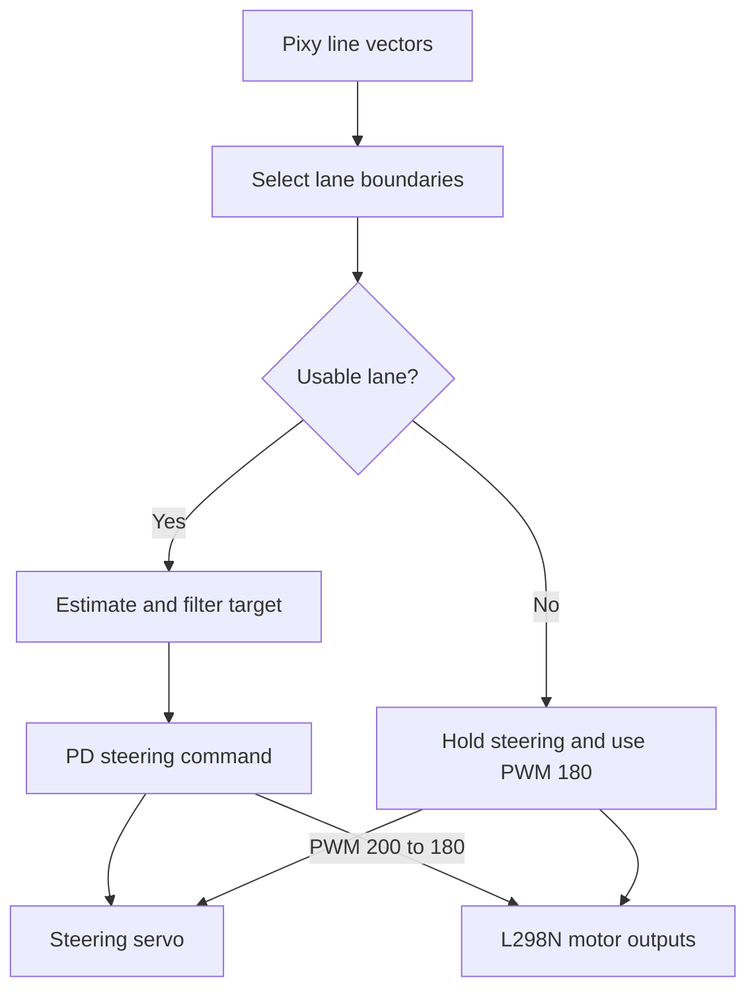

# Gorilla Turbo — NXP Cup Autonomous Car

Gorilla Turbo is a miniature autonomous car developed by an INSAT student team for the NXP Cup 2026 project. A Pixy2.1 camera detects the track boundaries, a Teensy 4.1 computes steering corrections, and a servo and two DC motors move the car through the track. The engineering challenge is to maintain a usable lane estimate through curves, incomplete detections and intersections while coordinating steering, propulsion and power delivery.



**[Watch the track demonstration](assets/media/gorilla-turbo-track-demo.mp4)** — 39-second MP4 showing track driving and a visible stop before a white box near the end. [Evidence and limitations](docs/VALIDATION.md#available-demonstrations-and-result-evidence).

The project demonstrates embedded C++ development, camera-to-controller integration, PD steering, PWM motor control, calibration and iterative debugging. Vision features are produced by the Pixy camera; the available firmware uses geometric rules and feedback control.

## Current status

**Priority: the fastest reliable lap through better track following, steering and curve-speed tuning. Obstacle stopping is a deferred bonus.** The repository now separates the track-following baseline, calibration utility and historical experiments. See the [architecture](docs/ARCHITECTURE.md) and [prioritized roadmap](docs/ROADMAP.md) for what exists and what is missing.

**A prototype photograph and track demonstration are included; the exact demonstrated firmware is not yet identified.** Start with [`firmware/track_following/track_following.ino`](firmware/track_following/track_following.ino). Its implementation comes from the source added on **7 April 2026** in commit [`81d8022`](https://github.com/Yasyous1/Gorilla-Turbo/commit/81d802210365757ba847fa165d7b237d982bb0b5); the repository reorganization preserves its bytes and settings. It is a development baseline, not a confirmed competition release or the proven source of the video.

The later team report describes final firmware with integrated ultrasonic stopping. That source was not recovered during the repository review. Several intermediate sketches and later uploaded tuning snapshots exist; their features and calibration values must be kept distinct. [Firmware history and evidence](docs/FIRMWARE_HISTORY.md) records those differences.

**Recorded build verification, 27 November 2026:** the earlier review compiled and linked 10 of 11 distinct variants for Teensy 4.1 using the documented dependency setup. The remaining archived camera/servo v3 sketch has an undeclared variable. The reorganization does not claim a new firmware build or physical-car test. See [validation](docs/VALIDATION.md) for the separate records.

| Capability | Newest tracked revision | Other evidence |
| --- | --- | --- |
| Camera line-vector acquisition over SPI | Implemented | Also present in earlier sketches |
| Two-boundary lane estimate and single-boundary fallback | Implemented | Lane-width memory and near/far target weighting |
| Filtered PD steering with limits and deadband | Implemented | Gains and center vary between revisions |
| L298N motor control and slower turns | Implemented | Open-loop PWM; no measured wheel-speed feedback |
| Intersection handling | Implemented as line-selection heuristics | No repeatable crossing results recorded |
| Finish-marker and ultrasonic stopping | **Not implemented in this revision; deferred bonus** | Earlier experiments contain partial handling; the report describes a latched stop in the missing final firmware. The supplied video shows a stop before a box, without identifying its software or trigger. |
| ML, odometry, SLAM or route planning | Not implemented | No claims of these capabilities are made |

**Operating behavior to know:** the newest motor firmware starts propulsion automatically after initialization. If camera vectors disappear, it keeps the last steering angle and drives at PWM 180. It has no obstacle stop or timed lost-line stop. Begin verification with motor power disconnected and the wheels lifted. See the [hardware verification procedure](docs/VALIDATION.md#physical-car-verification).

## Hardware

| Component | Role | Connection/status |
| --- | --- | --- |
| Teensy 4.1 | Embedded controller | Arduino/Teensy toolchain |
| Pixy2.1 | On-camera line detection | SPI: MOSI 11, MISO 12, SCK 13; default no-SS transport |
| Steering servo | Front-wheel steering | Signal pin 19; report names MG945, installed model needs confirmation |
| L298N and two DC motors | Propulsion | ENA/ENB: 2/3; IN1–IN4: 4/5/6/7 |
| HC-SR04 | Frontal range sensing | TRIG 23 / ECHO 22 in earlier integrated variants; unused by the latest source |
| LM2596, battery and PLA chassis | Power and mechanical platform | Reported 5 V regulated electronics/servo rail and INSAT FabLab chassis |

The pin table describes firmware and documented interface assignments. Physical motor-side labels conflict between the report and source comments, so the detailed reference uses channels A/B. Power ratings, level conversion and the installed wiring still need a hardware record. Read [hardware and wiring](docs/HARDWARE.md) before powering or reconnecting the car.

## How the reference firmware works

Each eligible loop iteration requests line vectors once. It normalizes their endpoints, groups candidates on the left and right of the image, and prefers useful long vectors near the car. A pair is accepted only when its width, width change, relative lengths and endpoint heights are plausible. Otherwise, the code uses a single boundary or a centered target.

The target is weighted **35% toward the near lane center and 65% toward the far center**. Remembered lane width supplies an offset when only one boundary is visible. Adaptive smoothing and a small deadband reduce rapid changes before the PD calculation:

```text
error       = filtered_target_x - image_center_x
correction  = KP * error + KD * (error - previous_error)
servo_angle = clamp(servo_center + steering_sign * correction)
```

The derivative term is a difference per update, not divided by elapsed time. The **20 ms gate** is a requested scheduling interval, not a measured deterministic control period. Steering deviation reduces the common motor command from **200 to 180**; those are PWM values, not physical speeds.



Reference settings are **center 105°**, limits **40–150°**, `KP=0.65`, `KD=0.15`, filter alpha **0.35/0.65**, deadband **2 pixels**, and a **20 ms** loop gate. The documentation improvements preserve all firmware settings and behavior.

## Build and use

The organized layout is available on the default **`main`** branch. The project retains **Arduino/Teensy**, using the PJRC board package and the Pixy2 Arduino library. `Servo`, `PWMServo` and `SPI` are supplied by the Teensy package. Python 3 is used only to prepare a standalone sketch on the development computer.

The track-following sketch has its own Arduino directory. Historical sources remain separate programs under `archive/firmware/`; select exactly one revision with the preparation helper:

```bash
git clone https://github.com/Yasyous1/Gorilla-Turbo.git
cd Gorilla-Turbo
python3 scripts/prepare_sketch.py --list
python3 scripts/prepare_sketch.py intersection
arduino-cli compile --fqbn teensy:avr:teensy41 \
  --library build/libraries/Pixy2 build/intersection
```

Install and stage the dependencies first using [the setup guide](docs/BUILD_AND_RUN.md). The helper creates an isolated sketch in `build/intersection/`, preserving the original source bytes; it does not upload firmware. Arduino IDE users can open `build/intersection/intersection.ino` after installing the prepared Pixy library as described in that guide.

The setup guide also covers USB upload, PixyMon configuration, serial diagnostics, the standalone `servo_calibration` sketch and operating checks. Record any new calibration against a specific firmware revision instead of copying values between experiments.

## Repository map

```text
Gorilla-Turbo/
├── firmware/
│   ├── track_following/track_following.ino
│   └── calibration/servo_calibration/servo_calibration.ino
├── archive/firmware/        Historical experiments and notes
├── hardware/               Component inventory and missing hardware records
├── docs/                   Architecture, build guide, evidence and roadmap
├── assets/media/           Original prototype photo and track video
├── scripts/                Sketch and Pixy dependency preparation
└── tests/                  Host checks for sketch preparation
```

| Start here | Purpose |
| --- | --- |
| [`firmware/README.md`](firmware/README.md) | Track-following and calibration entry points, with their status and different settings |
| [`docs/ARCHITECTURE.md`](docs/ARCHITECTURE.md) | Current code flow, directory responsibilities and future module boundaries |
| [`docs/ROADMAP.md`](docs/ROADMAP.md) | Available material, missing evidence and fastest-lap priorities |
| [`hardware/README.md`](hardware/README.md) · [`docs/HARDWARE.md`](docs/HARDWARE.md) | Populated component inventory, source-defined pins and hardware details still needed |
| [`archive/README.md`](archive/README.md) · [`archive/PATHS.json`](archive/PATHS.json) | Historical experiments and the complete old-to-new path map |
| [`docs/BUILD_AND_RUN.md`](docs/BUILD_AND_RUN.md) | Dependency setup, one-sketch builds, upload and calibration |
| [`docs/FIRMWARE_HISTORY.md`](docs/FIRMWARE_HISTORY.md) | Revision inventory, source evidence and preserved contribution credits |
| [`docs/ENGINEERING_NOTES.md`](docs/ENGINEERING_NOTES.md) | Difficulties, implemented responses and unresolved behavior |
| [`docs/VALIDATION.md`](docs/VALIDATION.md) · [`tests/`](tests/) | Recorded firmware builds, repository checks and physical verification still needed |

All existing firmware and historical note content is retained. Source moves are mapped explicitly; old commits remain available in Git history. The archive is not a collection of alternative final releases.

## Team and individual contributions

**Team:** Youssef Elloumi, Nesrine Ben Miled and Ilyess Biskri, supervised by M. Abderrazek Chatti, as credited in the project report.

**Youssef Elloumi — [`Yasyous1`](https://github.com/Yasyous1):** the Git history records repository setup, the Day 2 integrated control experiment, serial plotting, an interactive servo-calibration sketch, reviews of perception/control limitations, the later motor/steering integration and the intersection-filtering revision. These records support contributions to embedded firmware integration, calibration, debugging and control refinement. They do not establish sole authorship of all uploaded code or sole ownership of the hardware design.

**Nesrine Ben Miled — [`Ness3380`](https://github.com/Ness3380):** the history records the initial camera/servo and `TRY2` experiments, the alternative motor integration, subsequent steering-test revisions and the April 5 integrated L298N sketch. The later motor and intersection work builds on that shared firmware evolution.

**Ilyess Biskri and collective work:** the report credits the three-person team for the prototype, integration and testing, without assigning subsystem ownership by individual. Mechanical fabrication, power integration and track testing remain collective contributions unless more specific records are supplied. [Commit-linked attribution](docs/FIRMWARE_HISTORY.md) provides the evidence behind this summary.

## Demonstrations and results

Youssef supplied the following media on **27 November 2026**. Both files are preserved without image editing, video trimming or transcoding. Their recording dates and the demonstrated firmware revision have not been established.

- **[Prototype photograph](assets/media/gorilla-turbo-prototype.jpg):** shows the magenta camera mast and printed mounts, front ultrasonic sensor, clear chassis plates, battery holders, controller board and wiring. Individual pin connections and component ratings cannot be verified from this view.
- **[Track demonstration](assets/media/gorilla-turbo-track-demo.mp4):** shows the car travelling through straight and curved sections of the marked track. A white box is placed ahead near the end; the car approaches and remains stationary with a visible gap during approximately **37–39 seconds**. This is visual evidence of a demonstration, not proof of the stopping threshold, trigger, persistent-stop logic or source revision.

The **39.37-second video duration is not a measured lap time**. There are no recorded speed measurements, stopping-distance measurements or repeatability scores. The report's validation sheet is blank and its validation table lists criteria, so those are not presented as completed measurement logs. The [validation document](docs/VALIDATION.md#available-demonstrations-and-result-evidence) records the media observations and separates them from software checks and tests still requiring the car.

## Known limitations and next improvements

1. Identify the actual firmware running on the car and establish a measured baseline: complete laps, lap times, failed runs and exact source/configuration.
2. Verify steering center and direction, camera setup and loaded power behavior on the assembled car; add annotated wiring, component specifications and CAD when available.
3. Improve lap performance through recorded PD/filter and steering-dependent PWM trials. No optimal gains or measured fastest configuration have been established.
4. Measure loop timing, lane-loss duration and crossing repeatability. Design camera-failure, prolonged line-loss and arming behavior as explicit, separately tested firmware changes.
5. Revisit finish-marker and obstacle stopping after the lap-performance work. Encoder feedback and other larger control changes remain future options.

The [roadmap](docs/ROADMAP.md) states the evidence needed to complete each item. Missing results and source files are not filled with guessed values.

## Credits and licensing

The project uses the [PJRC Teensy ecosystem](https://www.pjrc.com/teensy/) and [Pixy2 software](https://github.com/charmedlabs/pixy2). Their authors and upstream license notices remain applicable to those dependencies. Existing team contributions and source comments are retained. No project-wide license was present at review time; choosing or changing one is left to the maintainers.
