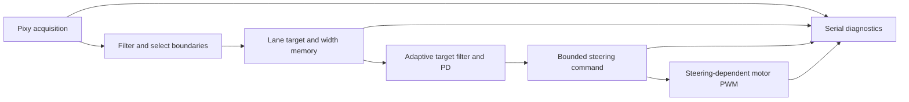

# Repository and firmware architecture

[Back to README](../README.md) · [Build and run](BUILD_AND_RUN.md) · [Roadmap and missing material](ROADMAP.md)

The repository is organized for **fast, reliable track following**. It gives the existing driving baseline one clear entry point, keeps calibration separate, and preserves older experiments as evidence. This is a source organization change: the firmware implementation and its settings are preserved.

## Directory responsibilities

```text
Gorilla-Turbo/
├── README.md
├── firmware/
│   ├── README.md
│   ├── track_following/
│   │   └── track_following.ino
│   └── calibration/
│       └── servo_calibration/
│           └── servo_calibration.ino
├── archive/
│   ├── README.md
│   ├── PATHS.json
│   └── firmware/              Earlier source files and notes
├── hardware/
│   └── README.md              Known components and missing specifications
├── docs/
│   ├── ARCHITECTURE.md
│   ├── ROADMAP.md
│   ├── BUILD_AND_RUN.md
│   ├── HARDWARE.md
│   ├── FIRMWARE_HISTORY.md
│   ├── ENGINEERING_NOTES.md
│   └── VALIDATION.md
├── assets/media/              Original prototype photo and track video
├── scripts/                  Sketch/dependency preparation tools
└── tests/                    Host checks for the preparation workflow
```

| Location | What belongs here | Present status |
| --- | --- | --- |
| [`firmware/track_following/`](../firmware/track_following/) | The baseline to build and extend for lap performance | Latest tracked intersection-handling implementation, moved without source changes; not identified as the firmware in the video |
| [`firmware/calibration/`](../firmware/calibration/) | Standalone bench calibration tools | Existing serial-controlled servo utility; its historical settings differ from the driving baseline |
| [`archive/firmware/`](../archive/firmware/) | Earlier complete programs, duplicates, known incomplete experiments and historical notes | Existing content retained; build each program separately through its alias |
| [`archive/PATHS.json`](../archive/PATHS.json) | Old-to-new source/notes locations | Migration record for locating renamed or archived material |
| [`hardware/`](../hardware/) | Component inventory and eventual physical design records | Populated inventory; actual schematic, CAD and several installed specifications are still missing |
| [`docs/`](./) | Operating instructions, design reasoning, evidence and priorities | Existing documentation plus this architecture and the roadmap |
| [`assets/media/`](../assets/media/) | Original photos and recordings | Supplied photograph and demonstration video, with integrity information in validation |
| [`scripts/`](../scripts/) | Reproducible preparation on the development computer | Existing 11-variant sketch selector and checksum-verified Pixy header preparation |
| [`tests/`](../tests/) | Automated checks that can run without the car | Preparation workflow checks; firmware algorithm and physical performance tests remain future work |

No empty configuration, control, perception or CAD directories are presented as implemented features. The existing firmware is a single sketch; the module boundaries below describe its responsibilities and a later extraction plan.

## The code that exists now

The primary entry point is [`track_following.ino`](../firmware/track_following/track_following.ino). It preserves the implementation introduced in [commit `81d8022`](https://github.com/Yasyous1/Gorilla-Turbo/commit/81d802210365757ba847fa165d7b237d982bb0b5). `setup()` initializes the motor pins, steering servo and Pixy line program; the existing motor behavior begins automatically after initialization.

Each eligible `loop()` update follows this pipeline:



| Responsibility | Existing implementation | Important behavior |
| --- | --- | --- |
| Camera input | `pixy.line.getAllFeatures(LINE_VECTOR)` in `loop()` | One acquisition per control update; Pixy supplies detected vectors over SPI |
| Candidate filtering | `filterLines()`, `sortVectorsByLength()`, `getBottomTopFromPixyIndex()` | Normalizes endpoints, filters orientation and separates left/right candidates |
| Boundary selection and target | `pickBestVectorIndex()`, `isPrimaryVector()`, `computeTargetX()` and single-vector helpers | Checks pair width, continuity, relative length and endpoint consistency; ambiguous pairs can fall back to image center |
| Lane-width memory | `updateLaneWidthMemory()` and `lastLaneWidthPx` | Supplies an offset when only one boundary is usable |
| Target filtering and PD | Arithmetic in `loop()`, `filteredTargetX`, `lastError` | Adaptive smoothing, pixel deadband and derivative as error difference per update |
| Steering output | `setSteeringServo()` and `PWMServo` | Constrains commands to the existing steering limits |
| Motor output | `computeSpeed()`, `setMotors()`, `stopMotors()` | Reduces common PWM as steering deviation increases; no measured wheel-speed feedback |
| Diagnostics | `Serial.print()` calls in `loop()` | Lane counts, remembered width, error, steering and PWM commands; no saved run log or measured loop-duration stream |

The pins, gains, filters and speed values are **embedded constants in the sketch**, not an external configuration system. The baseline retains center **105°**, steering limits **40–150°**, `KP=0.65`, `KD=0.15`, PWM **200–180**, filter factors **0.35/0.65**, and a **20 ms gate**. That gate is not a measured deterministic execution period.

When camera data or valid lines are missing, the baseline keeps the last steering command and continues at PWM 180. There is no explicit arming state, camera-fault state or timed lost-line stop. Changing that policy is firmware work with its own tests, rather than a side effect of reorganizing directories. The baseline also lacks finish-marker and obstacle stopping; the latter remains a deferred bonus.

## Separate calibration and archived variants

The [calibration utility](../firmware/calibration/servo_calibration/servo_calibration.ino) is an independent program using `Servo.h`. It starts at **84°** and permits **40–128°**; the track-following program uses `PWMServo.h`, center 105° and different limits. Neither program proves the current car's mechanical center. Disconnect propulsion, measure the assembled linkage, then deliberately record any verified settings in the chosen driving revision.

Archived sources are complete experiments, not interchangeable modules. Some contain ultrasonic or marker logic, different pin assignments or different error definitions. The known incomplete camera/servo v3 sketch remains archived and is not a recommended baseline. [Firmware history](FIRMWARE_HISTORY.md) records each variant and credits; [build instructions](BUILD_AND_RUN.md) retain all existing aliases.

## Module boundaries for a later refactor

After establishing a measured lap baseline, the existing responsibilities can be extracted into the following modules. **These module files do not exist yet**, and the current reorganization does not claim otherwise.

| Proposed module | Responsibility to extract from the current sketch | Verification needed before adopting it |
| --- | --- | --- |
| `config.h` | Existing pins and tuning constants | Exact constant comparison; no silent recalibration |
| `vision` | Camera acquisition and vector normalization | Recorded input frames, empty frames and camera-error cases |
| `lane_tracking` | Boundary selection, target calculation and lane-width memory | Straight, curve, single-boundary and ambiguous-crossing fixtures |
| `steering_control` | Adaptive filter, PD state and bounded angle calculation | Matching command sequences for the same input history and update schedule |
| `motor_control` | Direction outputs and steering-dependent PWM mapping | Boundary-value checks and raised-wheel channel/direction verification |
| `telemetry` | Run identifiers, diagnostics and timing measurements | Logs tied to the exact source and configuration without unacceptable loop overhead |

Extraction should preserve outputs before any gains, filters, timing or speed policy are changed. A new control behavior should be reviewed and measured separately so its effect on lap performance can be assessed.

## Development workflow

1. Build the primary sketch or explicitly select an archived alias; record the source commit and toolchain.
2. Run the host preparation checks and the physical bench checks relevant to the change.
3. Establish complete-lap and failure records before tuning; retain failed runs.
4. Change one steering/filter or curve-speed parameter at a time and compare repeated runs under recorded conditions.
5. Archive run data and associated media, then decide whether the change improves the fastest reliable lap.

The [roadmap](ROADMAP.md) lists the missing source, measurements and hardware records needed to make this workflow reproducible.
